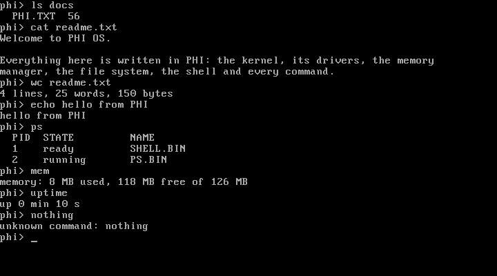

<h1>PHI Language</h1>
<h3>Soon operating systems will be as easy to code as desktop apps</h3>

PHI is a programming language that reads like plain words and compiles straight to machine
code. The same language writes a game with a window, a program that talks to a database,
and a whole operating system that boots on a bare PC.

```phi
phi.Hello:Program
{
	str name: [40];

	log 'What is your name? ';
	ask name;
	log 'Hello, ' name '!\n';
	exit 0;
}
```

`phi run hello.phi --target windows64` builds it and runs it. So does `--target macos` or
`--target linux64`: one source, three systems.

## Why PHI

- **Easy to read.** `x is 5`, `if lives atmost 0`, `while each star in stars`. No header
  files, no build scripts, no project files: a program is a `.phi` file.
- **One download, nothing else to set up.** PHI comes as a single zip. The compiler is one
  file, and the libraries most programs reach for are already in it.
- **Small, fast programs.** A PHI program is an ordinary executable with no runtime to
  install: the raylib example below is a 25 KB program beside raylib's own library. Over our
  benchmarks it takes about three-quarters of C#'s time and 1.14 times optimised C's
  ([the numbers](bench/RESULTS.md)).
- **C libraries from one line.** `use vendor.raylib;` and every function of raylib is there.
  Nothing to declare, nothing to link, nothing to install.
- **Safe by default, close to the machine when you ask.** Array indexes are checked, objects
  are freed for you with no garbage collector, and errors say which line. Pointers, ports,
  interrupts and assembly are there when you need them.
- **All the way down.** The same language writes the boot sector, the kernel, the drivers,
  the network stack and the programs that run on them.

## What you can make

### Games and apps, with the libraries you know

Nine libraries come with PHI, each complete: **raylib**, **SDL3**, **Vulkan**, **SQLite**,
**Lua**, **zlib**, **stb**, **miniaudio** and C's own library.

```phi
use vendor.raylib;

phi.Hello:Program
{
	call Ray.SetTraceLogLevel: Ray.LOG_WARNING;
	call Ray.InitWindow: 800 450 'Hello from PHI';
	while not (Ray.WindowShouldClose)
		call Ray.BeginDrawing;
		call Ray.ClearBackground: Ray.RAYWHITE;
		call Ray.DrawCircleV: (Ray.GetMousePosition) 30 Ray.MAROON;
		call Ray.DrawText: 'It works' 20 20 30 Ray.DARKGRAY;
		call Ray.EndDrawing;
	;;
	call Ray.CloseWindow;
	exit 0;
}
```

`phi run hello.phi --target macos` (or `windows64`, `windows`, `linux64`) opens the window.
The build puts the library beside your program, so the folder it makes is what you give to
someone else. [The vendor folder](vendor/README.md) has an example for each library.

### An operating system

`phi run samples/os.phi` boots PHI OS: a kernel with drivers, memory management, a file
system and processes, and a shell with commands and a game, all running as separate
programs. Almost all of it is written in PHI.



A complete kernel is this short. PHI adds the boot sector and switches the CPU into 32-bit
mode for you:

```phi
phi.Hello:Kernel
{
	log 'Hello from my own kernel!\n';
}
```

### A network stack, a desktop, a synthesizer

Everything in these is written in PHI, down to the hardware:

- **The network.** `phi run samples/web.phi` boots a kernel that fetches `https://` pages.
  The network card driver, TCP/IP, DNS, HTTP and TLS 1.3 with its cryptography are all PHI.

  ```phi
  use net.http;

  phi.Fetch:Kernel
  {
  	ptr<u8> page: new u8[65536];
  	bln ok: false;
  	call ok is Net.Start;

  	int size: 0;
  	call size is Http.Get: 'https://example.com/' page 65536;
  	log page;
  }
  ```

- **A desktop.** `phi run samples/desktop.phi` boots a desktop with a sketch pad, a notepad
  and a clock, each its own program in its own window. A crash in one closes only that
  window.
- **Music.** `phi run samples/music.phi` plays songs through a sound card driver and a
  four-voice synthesizer.
- **A multiplayer game server.** `phi run samples/mmo/server.phi` starts a server and three
  clients on one network.

## Get PHI

1. **Download** the zip for your system from the
   [releases page](https://github.com/BrandonHilde/PHI/releases): Windows (x64), Linux (x64)
   or macOS (Apple Silicon).
2. **Unzip it** anywhere. `phi` is inside, with the libraries and this documentation.
3. **Install NASM** (the assembler PHI drives), and **QEMU** if you want to boot kernels and
   PHI OS. On a Mac, also Apple's Command Line Tools (`xcode-select --install`).

Then, from the unzipped folder:

```
phi run samples/os.phi                                  boot PHI OS
phi run samples/raylib/ball.phi --target windows64      a window (or macos, linux64)
phi vendor                                              the libraries that come with PHI
```

In PowerShell, type `.\phi` for a program in the current folder, or add the folder to your
`PATH`. [Getting started](docs/getting-started.md) walks through all of it in ten minutes.

## Learn PHI

- **[Getting started](docs/getting-started.md):** install the tools and boot PHI OS
- **[The tutorial](docs/README.md#learn-phi):** eight parts, from a boot sector to adding a
  command to PHI OS, each with a tested example
- **[PHI for C programmers](docs/phi-for-c-programmers.md):** the differences that catch
  people out, and how to call C
- **[Language reference](docs/language.md):** every statement, type and built-in function
- **[The vendor folder](vendor/README.md):** the C libraries that come with PHI
- **[Samples](samples):** programs to read and run

## Where PHI is

PHI is at version 1.0. It builds:

| What | Where it runs |
|---|---|
| Programs for **Windows** and **Linux**, 32 and 64 bits | on that system |
| Programs and apps for **macOS** on Apple Silicon | on a Mac |
| **32-bit kernels** and the programs on them, and **PHI OS** | in QEMU |
| **16-bit** boot sectors and real-mode programs | in QEMU |

It has been tested on a Windows 11 PC, a Linux PC and a Mac. Kernels and PHI OS run in the
QEMU emulator; they haven't been run on real PC hardware yet. The
[release notes](docs/releases/1.0.0.md) say exactly what it has, how it was checked and what
it doesn't do yet.

## Going further

[ADVANCED.md](ADVANCED.md) is for when you want more: building PHI from its source, every
`phi` command, debugging and profiling, how the compiler works, the tests and benchmarks,
and the roadmap. [CONTRIBUTING.md](CONTRIBUTING.md) is for changing PHI itself.

## License

PHI is licensed under the [Apache License 2.0](./LICENSE). Programs built with PHI contain
code from its standard library, so if you distribute one, include [LICENSE](./LICENSE) and
[NOTICE](./NOTICE) with it. The libraries in the vendor folder are each under their own
licence, which is in their folder.
